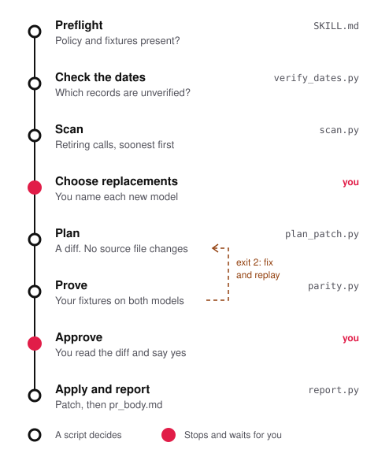
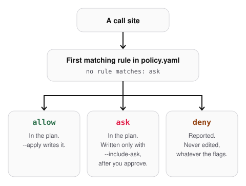
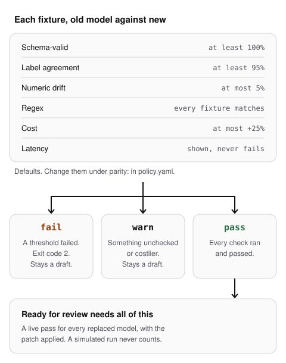
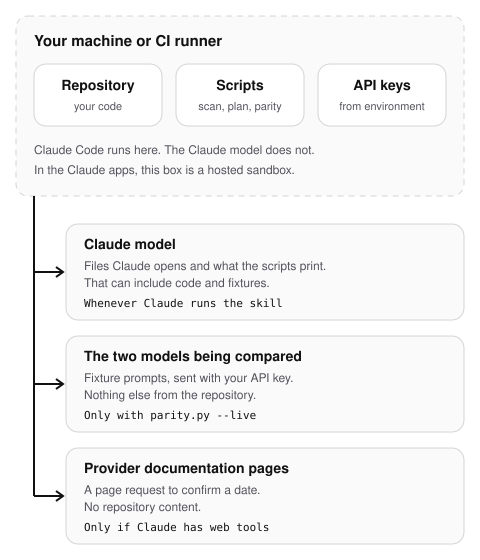

<picture>
  <source media="(prefers-color-scheme: dark)" srcset="docs/breakline-horizontal-dark.svg">
  
</picture>

Breakline finds the LLM model and API calls in a repo that are about to be retired, plans a deterministic fix, and proves the replacement behaves the same on your own saved prompts. It is an [Agent Skill](https://docs.claude.com/en/docs/agents-and-tools/agent-skills/overview), so Claude loads it when you ask things like "our gpt-4o calls die in January, fix them".

Claude drafts, explains and asks. The scripts decide.

[Website](https://aorta-pied.vercel.app) · [Download the skill](https://github.com/aorta-labs/breakline/raw/main/breakline.skill.zip) · by Aorta

## How a run goes

<p align="center">
  <picture>
    <source media="(prefers-color-scheme: dark)" srcset="docs/workflow-dark.svg">
    
  </picture>
</p>

## Requirements

- Python 3.10 or newer, and PyYAML: `python3 -m pip install pyyaml`
- For live parity: the provider keys in your environment (`OPENAI_API_KEY`, `ANTHROPIC_API_KEY`, or `OPENROUTER_API_KEY`) and fixtures in `<repo>/.breakline/fixtures/`

## Install

**Claude Code**

```bash
curl -LO https://github.com/aorta-labs/breakline/raw/main/breakline.skill.zip
mkdir -p ~/.claude/skills
unzip breakline.skill.zip -d ~/.claude/skills        # every project
# or, for one repo:
unzip breakline.skill.zip -d <repo>/.claude/skills
```

Start a new session and ask about a retiring model. `/skills` lists it.

**Claude apps.** Upload `breakline.skill.zip` in the app's skills settings (code execution must be on). In the apps the scripts run in a sandbox, so upload or attach the repo you want checked. Live parity needs network access to the model APIs, which a sandbox may block; use Claude Code for live runs.

**Agent SDK.** Place the folder at `<working dir>/.claude/skills/breakline`, load project settings and allow the `Skill` tool:

```python
from claude_agent_sdk import ClaudeAgentOptions, query

options = ClaudeAgentOptions(
    cwd="/path/to/repo",
    setting_sources=["project"],
    allowed_tools=["Skill", "Read", "Grep", "Glob", "Edit", "Bash(python3:*)"],
)
async for message in query(prompt="is anything in this repo deprecated?", options=options): ...
```

## What you control

Every call site is matched against `.breakline/policy.yaml` in your repo. See [policy format](breakline/references/policy-format.md).

<p align="center">
  <picture>
    <source media="(prefers-color-scheme: dark)" srcset="docs/policy-dark.svg">
    
  </picture>
</p>

## How parity decides

No model judges another model. Fixed checks compare the outputs, and the verdict comes from thresholds. See [parity checks](breakline/references/parity-checks.md).

<p align="center">
  <picture>
    <source media="(prefers-color-scheme: dark)" srcset="docs/verdict-dark.svg">
    
  </picture>
</p>

## What leaves your machine

The scripts call a model only in live parity. Claude itself is a hosted model, so whatever it reads while running the skill is sent to it. If some files must not be sent, do not run the skill on that repository through Claude; run the scripts directly.

<p align="center">
  <picture>
    <source media="(prefers-color-scheme: dark)" srcset="docs/boundary-dark.svg">
    
  </picture>
</p>

## Run the scripts without Claude

```bash
git clone https://github.com/aorta-labs/breakline && cd breakline
python3 breakline/scripts/scan.py breakline/tests/demo-repo
python3 breakline/scripts/plan_patch.py breakline/tests/demo-repo     # writes a diff, changes no source file
python3 breakline/scripts/parity.py breakline/tests/demo-repo --simulated   # demo only, calls no model
```

## What is inside

```
breakline/
├── SKILL.md              the workflow Claude follows
├── scripts/              scan, plan_patch, parity, report, verify_dates (JSON on stdout, exit 0/2/3)
├── lib/breakline/        vendored package: stdlib + PyYAML only
├── references/           registry.json, policy, fixtures and parity docs
├── assets/               policy.example.yaml
├── tests/                27 tests, including each script's CLI
└── evals/                12 prompts, a runner and the last results
```

## Develop

```bash
python3 -m pip install pyyaml pytest
python3 -m pytest tests                  # 27 tests
python3 evals/run_evals.py               # needs the `claude` CLI; spends API tokens
```

The evals start a headless Claude Code session per prompt in a throwaway copy of `tests/demo-repo`, with only this skill installed and no provider keys. Grading is rule-based: it reads the transcript and file hashes. See `evals/results.md`.

## What changed from the proof of concept

The package was copied from the PoC and fixed where a result could be wrong or unsafe:

- Parity no longer passes silently. A numeric field that disappears, or a regex that fails, is a failure. A missing price, a model with no fixtures or an expectation that cannot be evaluated is a warning.
- A report is never PASS when parity did not run for a replaced model, and a simulated run is labelled everywhere and can never make a PR ready.
- `--apply` writes only `allow` sites. `ask` sites need `--include-ask`. `deny` sites are never written.
- A repo's `router.yaml` cannot redirect fixture prompts or API keys to another address without `--allow-custom-endpoints`.
- CRLF files keep their line endings, non-ASCII lines are located correctly, and unquoted YAML values (`model: gpt-4o-2024-08-06`) are found.
- Every path and the date are flags, and the scripts run from any working directory.

## Limits

- The scanner matches exact model ids. Aliases, undated ids and provider-prefixed ids need a separate search, which `SKILL.md` asks Claude to do.
- The registry holds eight records and every date is marked unverified. `verify_dates.py` lists what to check. Claude fetches the provider's page when it has web tools.
- Parity is structural: it checks schema, labels, numbers, cost and latency on the fixtures you supply. It does not judge answer quality.
- JavaScript and TypeScript are scanned with a string tokenizer, not a full parser.

The diagrams are generated by `python3 docs/make_diagrams.py`.
